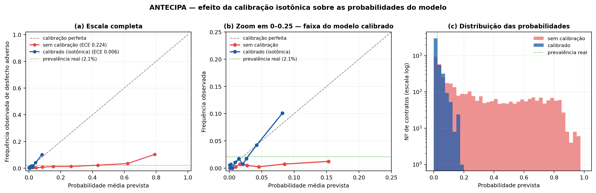
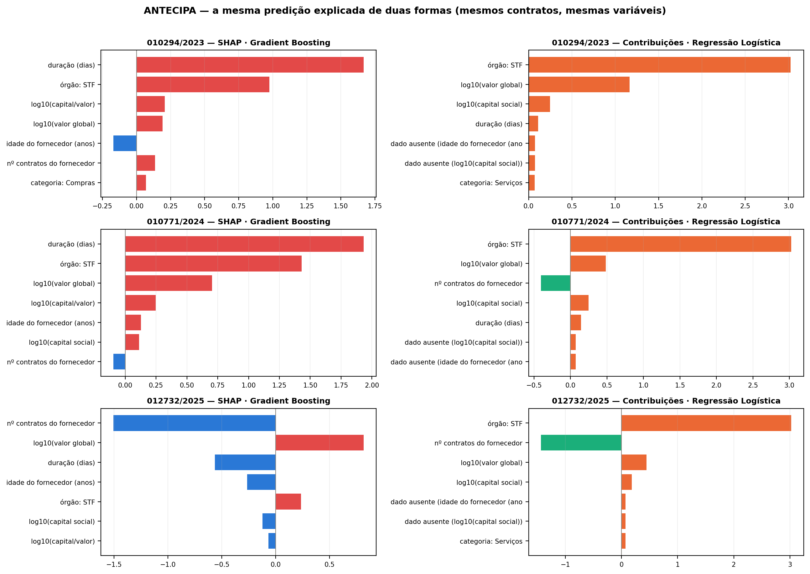

# ANTECIPA — Resultados técnicos e metodologia

Documento consolidado dos experimentos deste repositório: rotulagem, protocolo de
avaliação, resultados dos modelos e achados de engenharia de dados. Os relatórios
detalhados de cada experimento estão em `dados/processados/`. Visão geral do
pipeline e instruções de execução: [README.md](README.md).

Todos os dados são públicos (PNCP, compras.gov.br, dados abertos do CNPJ, Portal
da Transparência). Este é um protótipo acadêmico; os escores não constituem juízo
sobre nenhuma empresa.

> **Correções desta versão (18/11/2026).** (1) **Escala oficial da Res. STF
> 781/2022 adotada**, a partir dos anexos da norma: níveis 1·2·5·8·10 e risco
> inerente de 0 a 100. A versão anterior usava uma escala 1–5 linear com faixas
> próprias, que divergia da norma. (2) **Carteira do STF deduplicada**: os 365
> registros publicados no PNCP correspondem a 293 contratos únicos; os números da
> carteira divulgados antes contavam cópias. (3) **Sanções CEIS/CNEP integradas**
> via API oficial do Portal da Transparência. As correções (1) e (2) alteram a
> seção 5.4; os resultados formais do modelo (5.1–5.3) não mudam, pois usavam o
> dataset multi-órgão, já deduplicado. A escala oficial está centralizada em
> [`pipeline/escala_781.py`](pipeline/escala_781.py).
>
> **Correções de 19/11/2026.** (4) **Arredondamento**: a conversão de pontos em
> nível usava o `round()` do Python, que leva 0,5 ao par mais próximo (2,5 → 2),
> contrariando a regra documentada. Agora 0,5 arredonda para cima, como no
> Excel. (5) **Cobertura dos fatores de fornecedor**: capital, idade e situação
> cadastral eram avaliados só para os 15 maiores fornecedores (18 contratos); os
> demais recebiam um fator técnico de "perfil não coletado" (+0,3). Como o
> cadastro da Receita já havia sido coletado para todos, os fatores passaram a
> valer para 291 dos 293 contratos, com as mesmas regras do baseline avaliado na
> seção 5.1 (capital comparado ao valor do contrato; idade do CNPJ na data da
> assinatura), e o fator técnico foi retirado. Efeito combinado: a leitura
> ex-ante passou de 0 — como dizia a versão de 18/11 — para **2** alertas
> Elevado, nenhum com desfecho adverso. Os pesos estão centralizados em
> `escala_781.PESOS`.

---

## 1. Escopo e dados

| Fonte | Conteúdo | Volume |
|---|---|---|
| API de Consulta do PNCP | Contratos de 11 órgãos do Judiciário federal desde 2023 | 31.907 registros → **25.488 contratos únicos** |
| API do PNCP — termos | Aditivos, apostilamentos e rescisões, com data e valores | base do rótulo |
| API de busca do PNCP | Presença nacional dos maiores fornecedores do STF | top-15 da carteira |
| Dados abertos do CNPJ (Receita Federal) | Capital social, porte, idade, CNAE, situação cadastral | 9.598 de 9.600 fornecedores |
| Portal da Transparência — CEIS e CNEP | Sanções de empresas (inidoneidade, impedimento, suspensão, Lei Anticorrupção) | 232 fornecedores do STF |
| Pesquisa de preços do compras.gov.br | Distribuição nacional de preços homologados por item | 7 itens |

Recorte temporal: vigência plena da Lei 14.133/2021 (2023 em diante). Na carteira
do STF: **293 contratos únicos** (365 registros no PNCP), R$ 996 milhões, 179
termos aditivos, 16 rescisões/extinções, 62 contratos com desfecho adverso
(21,2 %).

## 2. Rotulagem pelo desfecho real

O rótulo **não** deriva da matriz de risco — deriva do que aconteceu depois da
assinatura, extraído dos termos publicados no PNCP: rescisão/extinção, acréscimo
de valor > 25 % ou prorrogação > 365 dias. Isso evita a circularidade de treinar
um modelo nos rótulos gerados pelas próprias regras que ele deveria superar.

Na **v2**, o rótulo ganhou **horizonte fixo de 12 meses** (evento datado pelo
termo) e só entram contratos com 12 meses completos de observação. A correção
eliminou um artefato de censura à direita: na v1 a prevalência "caía" de 5,2 %
no treino para 1,6 % no teste apenas porque contratos recentes ainda não tinham
tido tempo de acumular termos. Com horizonte fixo, a prevalência fica estável por
coorte de assinatura: **1,5 % (2023) · 1,7 % (2024) · 2,1 % (2025)**.

## 3. As três leituras de risco

**Escala oficial da Res. STF 781/2022.** Probabilidade e impacto têm cinco níveis
com valores **1 · 2 · 5 · 8 · 10** (Muito baixa/o, Baixa/o, Média/o, Alta/o, Muito
alta/o). O **risco inerente** é o produto dos dois, de 0 a 100, classificado em
**Baixo** (0–9,9) · **Moderado** (10–39,9) · **Elevado** (40–79,9) · **Crítico**
(80–100). A norma define ainda o **risco residual** = inerente × fator de eficácia
dos controles (1,0 · 0,8 · 0,6 · 0,4 · 0,2); como dados públicos não informam os
controles internos, o ANTECIPA calcula apenas o risco inerente.

Cada contrato é apresentado sob três leituras, que respondem a perguntas
diferentes. Duas são *ex-ante*; uma é retrospectiva.

**(a) Nível ex-ante — Res. 781/2022.** Escore heurístico que parte de 1,0 ponto e
soma apenas fatores conhecidos na assinatura, com base no cadastro aberto da
Receita de cada fornecedor: capital social < 2 % do valor do contrato `+1,2`
(> 30 % `−0,5`; não informado `+0,3`); CNPJ com menos de 3 anos na data da
assinatura `+0,8` (mais de 10 anos `−0,4`); crescimento contratual atípico ≥ 3× a
mediana no PNCP `+1,0` (série disponível só para os 15 maiores fornecedores);
situação cadastral ≠ "Ativa" `+1,5`; vigência > 12 meses `+0,4`; **sanção
CEIS/CNEP em vigor e já publicada na data da assinatura `+2,0`**. O total,
arredondado (0,5 para cima) e limitado a 1–5, indica o nível de probabilidade da
norma.

**(b) Probabilidade prevista — modelo supervisionado.** Gradient Boosting com
calibração isotônica (5 folds). Treino: 16.783 contratos de 11 órgãos
(2022–2025). Variáveis: apenas as disponíveis na assinatura. Na matriz, a
probabilidade vira nível da norma por faixas fixas — Muito baixa (1) < 2 % ·
Baixa (2) 2–5 % · Média (5) 5–10 % · Alta (8) 10–20 % · Muito alta (10) ≥ 20 % —
ancoradas na taxa base, não em quantis. A correspondência com os descritores
qualitativos é provisória: ≥ 20 % é mais de 11× a taxa base, mas está longe de
"praticamente certa".

**(c) Nível observado — Res. 781/2022.** O mesmo escore de (a) acrescido do que já
ocorreu: ≥ 2 aditivos `+0,8`; valor acumulado > 10 % acima do inicial `+0,8`;
rescisão/extinção registrada `+1,5`. Leitura retrospectiva — parte do que ela mede
já é o problema materializado.

Nas três leituras, o **impacto** é o quintil do valor global do contrato na
carteira (Muito baixo → Muito alto) — eixo comum que as torna comparáveis.

> **Ressalvas:** a norma traz descritores qualitativos ("Rara", "Provável"…), não
> regras de conversão — a tabela de pontos de (a) e (c) é operacionalização própria,
> em validação com os gestores de risco do STF (seção 8); e o escore ex-ante é uma
> reconstrução feita no presente, com os dados cadastrais atuais da Receita.

## 4. Protocolo de avaliação

Validação **temporal** (treino ≤ 2024, teste 2025), métricas próprias de classe
rara — precision, recall e F1 da classe positiva, PR-AUC e ROC-AUC; **nunca
acurácia**. O limiar de decisão é escolhido no treino (máximo F1 em validação
cruzada), jamais no teste. O baseline heurístico é avaliado nas mesmas condições,
com alerta = Elevado ou Crítico na escala oficial (risco inerente ≥ 40).

## 5. Resultados

### 5.1 Modelo principal — teste temporal 2025

| Modelo | Precision | Recall | F1 | PR-AUC | ROC-AUC |
|---|---|---|---|---|---|
| **Gradient Boosting v2 (12 meses)** | 0,109 | 0,494 | 0,179 | **0,139** (lift 6,6×) | 0,806 |
| Regressão Logística v2 | 0,052 | 0,647 | 0,096 | 0,065 | 0,755 |
| Gradient Boosting v1 | 0,064 | 0,393 | 0,111 | 0,071 (lift 4,4×) | 0,798 |
| Baseline heurístico (Res. 781, escala oficial) | 0,032 | 0,036 | 0,034 | 0,031 (lift ~1,9×) | 0,703 |

Na escala oficial o baseline emite 156 alertas no teste de 2025 e acerta 5 dos
140 desfechos adversos. Visão operacional do modelo: entre os 100 contratos de 2025
com maior escore v2, **16 tiveram desfecho adverso real** em 12 meses — 7,6× a
taxa base — capturando 19 % de todos os adversos do ano.

Detalhes: [`relatorio_modelo.md`](dados/processados/relatorio_modelo.md) (v1),
[`relatorio_modelo_v2.md`](dados/processados/relatorio_modelo_v2.md) (v2).

### 5.2 Treinar só com STF × multi-órgão

Mesmo teste (contratos do STF assinados em 2025: 106 contratos, 13 adversos). O
modelo só-STF (148 contratos de treino) obteve PR-AUC 0,384; o multi-órgão
(12.483 contratos), 0,319. **Bootstrap com 4.000 reamostras: Δ = +0,069, IC 95 %
[−0,221; +0,350]** — diferença não conclusiva. No mesmo teste, o baseline na
escala oficial emite 3 alertas e não acerta nenhum.

Leitura equilibrada: o padrão local do STF carrega sinal específico relevante (sua
carteira tem prevalência de desfecho adverso muito superior à dos demais órgãos),
mas o multi-órgão entrega desempenho comparável com 84× mais dados e muito mais
estabilidade. Caminho sugerido: treinar no padrão nacional e calibrar por órgão.

Detalhes: [`comparacao_stf_vs_multi.md`](dados/processados/comparacao_stf_vs_multi.md).

### 5.3 Calibração das probabilidades

O treino com `class_weight='balanced'` distorce a escala de saída: o número
produzido é escore inflado, não probabilidade. A calibração isotônica aprende, dos
próprios dados, o mapeamento entre escore e frequência observada.

| Métrica (teste temporal 2025) | Sem calibração | Calibrado | Referência |
|---|---|---|---|
| Probabilidade média prevista | 24,5 % | **2,0 %** | 2,1 % (frequência real) |
| ECE — erro de calibração esperado | 0,2240 | **0,0063** | 0 (ideal) |
| Brier score | 0,1280 | **0,0196** | menor é melhor |
| ROC-AUC (discriminação) | 0,8064 | 0,8019 | — |

O modelo bruto prevê em média 24,5 % onde a frequência real é 2,1 % —
superestimativa de ~12×. Após a calibração, a média coincide com a realidade e o
ECE cai 36×. **O ROC-AUC permanece essencialmente inalterado**: como a
transformação é monotônica, a ordenação é preservada — a calibração torna a escala
interpretável sem alterar a capacidade de discriminar.

Reproduzir: `python pipeline/diagrama_calibracao.py`.

### 5.4 Na escala oficial, a matriz ex-ante emite só dois alertas — e erra ambos

Critérios de alerta aplicados aos 293 contratos do STF (taxa base de desfecho
adverso: **21,2 %**):

| Critério de alerta | Alertas | Acertos | Precisão | Recall | Lift |
|---|---|---|---|---|---|
| **Ex-ante (Res. 781) — Elevado/Crítico** | **2** | 0 | 0,0 % | 0,0 % | 0,00× |
| Ex-ante (Res. 781) — Moderado ou acima | 72 | 14 | 19,4 % | 22,6 % | 0,92× |
| Ex-ante top-50 (ordenado pelo escore) | 50 | 11 | 22,0 % | 17,7 % | 1,04× |
| **ML top-50 (probabilidade)** | 50 | 27 | **54,0 %** | 43,5 % | **2,55×** |
| Ex-ante top-100 | 100 | 21 | 21,0 % | 33,9 % | 0,99× |
| ML top-100 | 100 | 49 | 49,0 % | 79,0 % | 2,32× |
| ML ≥ 20 % | 82 | 45 | 54,9 % | 72,6 % | 2,59× |
| ML ≥ 10 % | 128 | 51 | 39,8 % | 82,3 % | 1,88× |
| ML ≥ 5 % | 184 | 56 | 30,4 % | 90,3 % | 1,44× |
| *(referência, circular)* Observado — Elevado/Crítico | 19 | 15 | 79,0 % | 24,2 % | 3,73× |

**Na escala oficial, a leitura ex-ante classifica apenas dois contratos como
Elevado — e nenhum deles teve desfecho adverso.** Com os fatores disponíveis
antes da assinatura, a probabilidade ex-ante de 291 dos 293 contratos fica em
Muito baixa (1) ou Baixa (2); mesmo com impacto máximo (10), o risco inerente
desses chega no máximo a 20 — Moderado. As exceções somam 2,5 e 2,6 pontos, que
arredondam para Média (5): o maior contrato da carteira (consórcio de facilities,
R$ 587 milhões — capital não informado, empresa recente e vigência longa), com
impacto 10 e risco 50; e um contrato de R$ 350 mil cujo fornecedor tem capital
abaixo de 2 % do valor contratado, com impacto 8 e risco 40. Na matriz do painel,
todos os demais contratos ocupam apenas as duas primeiras colunas. Relaxando o
critério para "Moderado ou acima", a precisão (19,4 %) fica **abaixo da taxa
base** (lift 0,92×); ordenando pelo escore contínuo, os 50 primeiros contêm 11
desfechos adversos — enquanto os 50 primeiros do modelo contêm **27, cerca de
2,5 vezes mais**.

Ressalvas: (i) os números do ML aqui são **otimistas** — contratos do STF
integraram o treino; a medição fora da amostra é a da seção 5.1; (ii) o rótulo
aqui é o mais frouxo ("adverso a qualquer momento"), então **lift** é a coluna
comparável entre contextos; (iii) o "quase nenhum alerta" resulta da escala
oficial **combinada com a nossa tabela de pontos** — se a validação com o STF
alterar os pesos, o número muda (a planilha de validação traz um simulador para
isso); (iv) a carteira do STF é homogeneamente de alto risco pelos critérios da
norma (serviço continuado, longo, de valor elevado), o que satura as variáveis
discriminantes; (v) a leitura observada tem precisão alta justamente por ser
circular — usa o desfecho que pretende sinalizar.

Reproduzir: `python pipeline/metricas_carteira_stf.py` →
[`metricas_carteira_stf.md`](dados/processados/metricas_carteira_stf.md).

**Probabilidade pura × matriz — réguas para perguntas diferentes.** A matriz do
ML (probabilidade convertida em nível da norma × impacto) e o ranqueamento pela
probabilidade pura otimizam objetivos distintos:

| Critério | Alertas | Acertos | Precisão | Recall | Lift |
|---|---|---|---|---|---|
| Matriz ML — Elevado/Crítico | 91 | 29 | 31,9 % | 46,8 % | 1,51× |
| Matriz ML — só Crítico | 40 | 18 | 45,0 % | 29,0 % | 2,13× |
| ML ≥ 20 % (prob. pura, volume ~igual) | 82 | 45 | 54,9 % | 72,6 % | 2,59× |
| ML top-50 (prob. pura) | 50 | 27 | 54,0 % | 43,5 % | 2,55× |

Em volume semelhante (91 e 82 alertas), a probabilidade pura é mais precisa que a
matriz (54,9 % contra 31,9 %): multiplicar pelo impacto dilui o sinal preditivo,
porque o eixo de impacto — o quantil do valor — mede a **consequência** de um
problema, não a sua **probabilidade**. Não é defeito: a matriz otimiza **perda
esperada**, não taxa de acerto. Um contrato com 10 % de chance de problema em
R$ 500 milhões merece mais atenção que um com 25 % em R$ 50 mil, e é isso que a
ponderação por impacto captura, ao custo de errar mais em quantidade. **Use a
régua conforme a pergunta:** para "quais contratos vão dar problema?", ordene pela
probabilidade pura; para "onde alocar a diligência considerando o estrago
potencial?", use a matriz. Avaliar a matriz por precisão sobre o desfecho mede-a
por um objetivo que não é o dela — daí a coexistência das três leituras no painel.

### 5.5 Escolha da técnica de explicação: SHAP × modelo substituto

A primeira versão explicava cada contrato pelas contribuições de uma regressão
logística treinada nos mesmos dados — um **modelo substituto**, que explica a si
mesmo e não o Gradient Boosting do qual vem a probabilidade. A decisão de trocar
foi tomada por medição, não por preferência teórica:

| Indicador de concordância entre as duas explicações | Valor |
|---|---|
| Correlação de Spearman média entre as atribuições | 0,222 |
| Contratos em que o **fator principal coincide** | **12,3 %** |
| Sobreposição média entre os três principais fatores | 56,3 % |
| Contratos analisados | 293 |

Em ~9 de cada 10 contratos, o fator exibido como principal não era o principal do
modelo real. A causa é estrutural: em variáveis *one-hot*, a contribuição da
logística é o coeficiente × 1 — **constante para todo contrato do mesmo órgão**.
"órgão: STF" aparecia como fator nº 1 em praticamente todos os casos, com
magnitude fixa, dominando a explicação sem discriminar nada. A importância global
confirma a inversão: a variável de maior peso no GB (**duração**, 1,521) tinha
peso quase 10× menor na logística (0,156), enquanto "órgão: STF" liderava nesta
última (3,024) contra 0,810 no modelo real.

As explicações foram migradas para **SHAP (TreeExplainer) sobre o próprio Gradient
Boosting**. Duas providências acompanharam a migração: as contribuições dos níveis
de cada variável categórica passaram a ser **somadas por variável original** (sem
isso, o SHAP atribui valor a níveis que o contrato não assume — p. ex. "órgão:
TSE" em contrato do STF, medindo a contribuição de *não* ser do TSE); e mede-se a
fidelidade ao modelo publicado.

> **Ressalva de fidelidade:** o SHAP explica o GB ajustado sobre toda a base,
> enquanto a probabilidade vem do mesmo algoritmo calibrado em 5 partições.
> Concordância de ordenação: **Spearman 0,878** — muito acima dos 0,222 do
> substituto, porém inferior a 1. Parte da diferença é artefato de empates: a
> calibração isotônica é função em degraus e reduz os 293 contratos do STF a
> apenas **111 valores distintos** de probabilidade, o que penaliza o coeficiente
> de Spearman sem que haja discordância real de ordenação.
>
> O valor é medido a cada publicação do modelo e gravado em `ml_stf_v2.json`
> como `fidelidade_shap_spearman`; **o próprio dashboard exibe essa ressalva** no
> bloco "Como as três leituras são calculadas", de modo que quem consulta o
> painel conhece o limite da explicação sem precisar recorrer a esta documentação.
>
> Eliminar por completo o resíduo exigiria calibrar com `cv="prefit"` sobre um
> conjunto reservado — aí haveria um único modelo, e o SHAP explicaria exatamente
> o escore que alimenta a calibração. O custo seria retirar dados do ajuste do
> modelo, com apenas 296 casos positivos disponíveis. A opção atual privilegia a
> qualidade da calibração (ECE 0,006) e assume o resíduo de fidelidade, medido e
> divulgado.

Permanece defensável a alternativa oposta — publicar a própria regressão logística
como modelo, abrindo mão de ~metade do poder preditivo (PR-AUC 0,065 contra 0,139)
em troca de um sistema em que a explicação **é** o modelo. O que não se sustenta é
a combinação anterior: modelo de árvores explicado por modelo linear distinto.

Detalhes: [`comparacao_explicacoes.md`](dados/processados/comparacao_explicacoes.md).
Reproduzir: `python pipeline/compara_explicacoes.py`.

### 5.6 Sanções CEIS/CNEP dos fornecedores do STF

Os 232 fornecedores PJ da carteira foram consultados no CEIS e no CNEP pela API
oficial do Portal da Transparência (18/11/2026). **19 (8,2 %) têm registro — todos
no CEIS, nenhum no CNEP.** Um único fornecedor concentra quase 30 sanções,
incluindo declaração de inidoneidade pelo TCU e duas sanções aplicadas pelo
próprio STF.

- **Fator ex-ante (`+2,0`): disparou em 0 contratos.** Nenhum fornecedor tinha
  sanção em vigor e já publicada na data da assinatura. Todas as 66 combinações
  contrato–sanção referem-se a sanções iniciadas **depois** da assinatura. É o
  resultado esperado: a Lei 14.133/2021 (art. 91, § 4º) obriga a consultar CEIS e
  CNEP antes de formalizar o contrato — o controle prévio funciona.
- **23 contratos** têm fornecedor sancionado posteriormente (8 dessas combinações
  por sanção do próprio STF). O painel exibe essa informação no detalhamento de
  cada contrato, fora do escore ex-ante.
- **Verificação exploratória, resultado nulo.** A sanção posterior não se associa
  ao desfecho do contrato: desfecho adverso de 13,0 % nesses 23 contratos contra
  21,9 % nos demais (Fisher, p = 0,43); probabilidade mediana do modelo de 9,9 %
  contra 7,5 % (Mann-Whitney unilateral, p = 0,12). Com n = 23 o teste tem pouco
  poder, e as sanções refletem condutas com outros órgãos, enquanto o rótulo mede
  aditivos e prorrogações deste contrato. Não há, portanto, validação externa do
  modelo por essa via.

A chave da API é pessoal e **não** integra o repositório: `coleta_sancoes.py` a lê
de `PORTAL_TRANSPARENCIA_CHAVE` ou de `~/.antecipa/portal_transparencia.key`; sem
ela, o pipeline usa o cache versionado em `dados/brutos/sancoes_stf.json`.

## 6. Achados de engenharia de dados

1. **O STF não preenche `catalogoCodigoItem`** (CATMAT/CATSER) nos itens que
   publica no PNCP — 0 de 916 itens tinham o campo. A comparação nacional de
   preços exigiu reconstruir a ponte descrição → PDM → códigos via catálogo do
   compras.gov.br.
2. **As listas paginadas do PNCP contêm duplicatas** (republicações/retificações):
   o TST retorna 13.765 registros para 9.407 contratos únicos, e o próprio STF, 365
   registros para 293 contratos. Deduplicação por `numeroControlePncp` é
   obrigatória em qualquer uso analítico — inclusive no painel, que até a versão
   anterior somava as cópias.
3. **CNPJs raiz agregam unidades**: TST e TSE trazem as unidades regionais da
   Justiça do Trabalho e Eleitoral — útil para volume, exige atenção ao
   interpretar "órgão".
4. **Serviços continuados são publicados como item único de valor global**
   (quantidade 1), inviabilizando comparação unitária de preços de serviços sem
   normalização adicional.
5. **Consórcios aparecem com capital social zero** na base aberta da Receita — é
   dado não informado, não "empresa sem lastro"; o escore trata o caso à parte.
6. **A API do PNCP aplica rate-limit** (HTTP 429) em coletas longas; o pipeline usa
   retry com backoff e um passe de reparo (`repara_multi.py`).
7. **API do Portal da Transparência**: exige chave pessoal no cabeçalho
   `chave-api-dados`; filtro por CNPJ em `codigoSancionado`; páginas de 15
   registros; limite de ~90 requisições/minuto em horário diurno. As datas vêm no
   formato `dd/mm/aaaa` e o fim da sanção pode ser indeterminado.

## 7. Limitações

- O rótulo captura desfechos administráveis (aditivos, prorrogações, rescisões) —
  não fraude ou conluio, raros e não observáveis nestas bases. O PNCP também não
  distingue o **motivo** da rescisão (inadimplemento × conveniência da
  Administração), o que torna o rótulo um proxy grosseiro.
- O horizonte de 12 meses não captura desfechos tardios (p. ex. aditivos do 2º ano
  de serviços continuados); sensibilidade com 18/24 meses fica como extensão.
- `nº contratos do fornecedor` é contado no dataset completo — leve vazamento
  temporal; em produção, contar apenas contratos anteriores à assinatura.
- A precisão absoluta dos alertas é baixa (classe rara): o uso correto é
  ranqueamento com fila por capacidade de diligência, com decisão sempre humana.
- **O painel calcula só o risco inerente.** O risco residual da norma depende da
  avaliação da eficácia dos controles internos de cada unidade, que não é dado
  público.
- **As explicações SHAP não decompõem exatamente a porcentagem exibida.** Elas
  descrevem o Gradient Boosting ajustado sobre toda a base, enquanto a
  probabilidade provém do mesmo algoritmo calibrado em 5 partições — concordância
  de ordenação de **0,878** (Spearman), parcialmente reduzida pelos empates da
  calibração isotônica (ver 5.5). A alternativa que eliminaria o resíduo seria
  calibrar com `cv="prefit"` sobre um conjunto separado, ao custo de reduzir os
  dados de ajuste do modelo.
- Comparações de preço por PDM agregam especificações heterogêneas: desvios
  disparam diligência, nunca conclusão de sobrepreço.
- Sanções CEIS/CNEP foram consultadas só para os fornecedores do STF e entram no
  escore heurístico, não no modelo supervisionado. SICAF e CNDT seguem fora — não
  há API pública.
- Pequenas lacunas de coleta permanecem onde o rate-limit persistiu (TRF5/2026 e
  páginas profundas de TST/TSE 2023).

## 8. Nota sobre a operacionalização da Res. 781/2022

Os anexos da Resolução (escalas de probabilidade, de impacto, de nível de risco e
de eficácia dos controles) foram incorporados nesta versão, e a escala oficial
substituiu a régua linear 1–5 usada antes. Eles confirmam, porém, que a norma
traz apenas **descritores qualitativos** — "Rara", "Improvável", "Possível",
"Provável", "Praticamente certa"; impacto "Insignificante" a "Catastrófico" — e
**não define como converter dados observáveis em níveis**. A tabela de pontos da
seção 3 é, portanto, operacionalização proposta neste trabalho, em **validação
com os gestores de risco do STF**. O mesmo vale para a correspondência entre as
faixas de probabilidade do modelo e os descritores da norma.

Importante: o resultado central (modelo supervisionado) **não depende dessa
tabela** — o rótulo vem do desfecho real, justamente para escapar da
circularidade. O que depende dela é a leitura ex-ante e, portanto, o achado da
seção 5.4.
